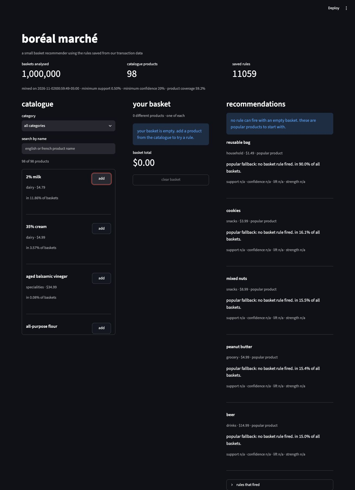
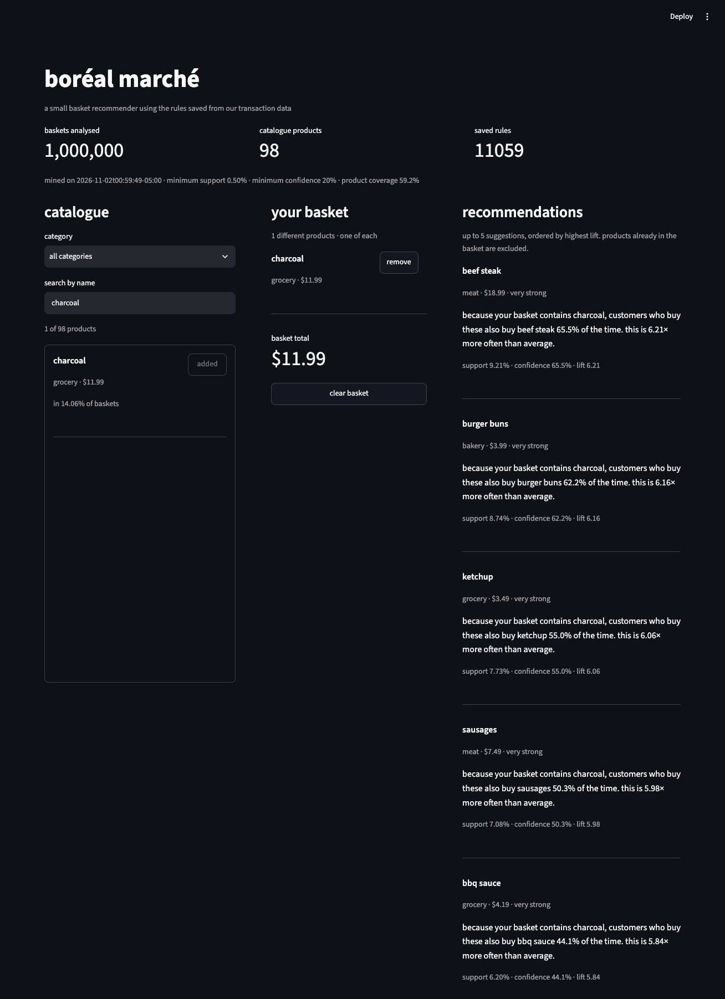
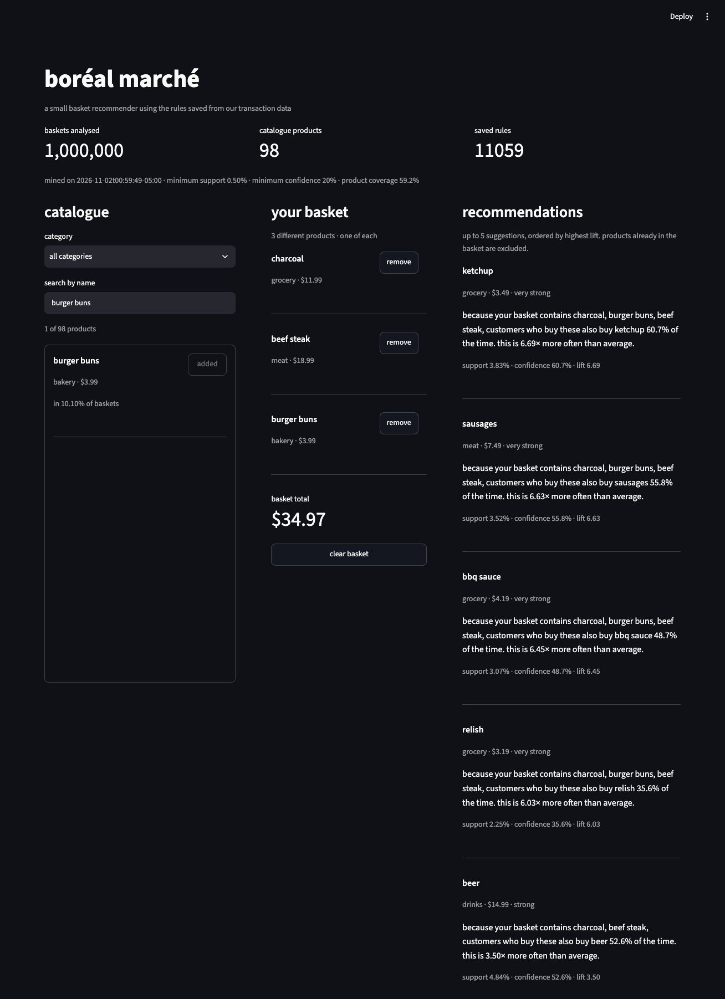
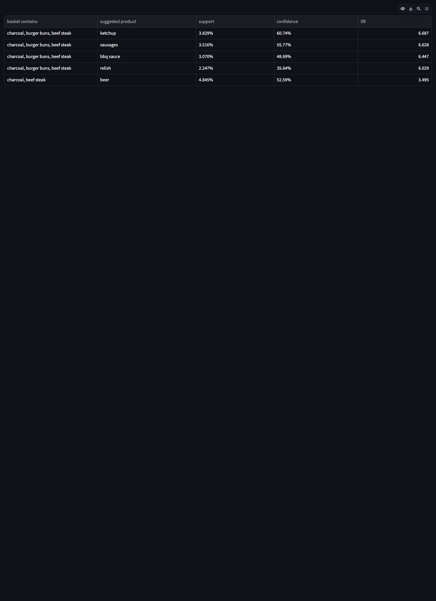
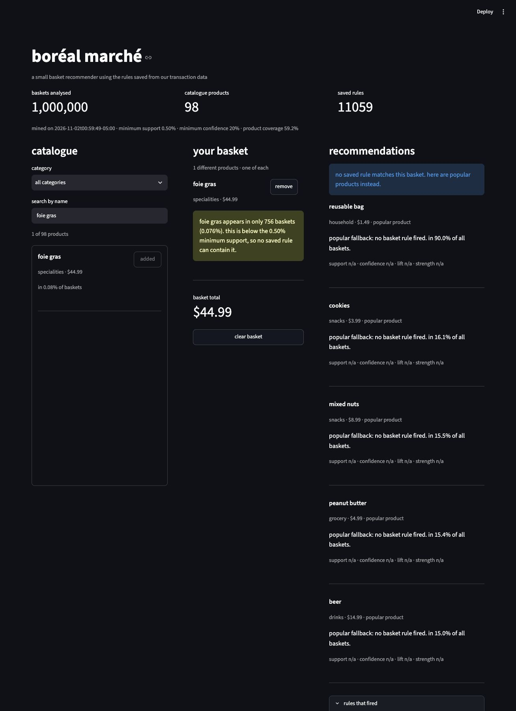

# boréal marché

github repository: [temelal/boreal-reco-temel-melal](https://github.com/temelal/boreal-reco-temel-melal)

i built a small basket recommender from the full grocery transaction file. the notebook does the mining offline. the shop application reads the saved rules and explains each suggestion.

## run the application

use python 3.12. these commands work from this project folder on macos or linux. the recorded measurements and local checks were made on macos with python 3.12.14.

```bash
python3.12 -m venv .venv
source .venv/bin/activate
python -m pip install -r requirements.txt
streamlit run app/streamlit_app.py
```

the requirements file pins the environment used here. the supplied data, executed notebook and generated models are included, so mining is not needed to open the application.

## files and data

- `data/transactions.zip`: the supplied transactionsdata.zip archive, copied under the expected name.
- `data/products.csv`: the original 98-product catalogue.
- `notebooks/01_mining.ipynb`: the complete executed analysis, including the prediction written before mining.
- `notebooks/mining_worker.py`: a separate process for each apriori experiment, to measure its own time and peak memory.
- `models/rules.json` and `models/metadata.json`: saved rules, parameters, mining date, frequencies and coverage.
- `app/streamlit_app.py` and `app/recommender.py`: the interface and the small recommendation functions.
- `reports/benchmark.md`: the four measured support runs and the memory-error experiment.
- `reports/analysis_results.json`: the numeric results exported by the notebook.
- `reports/duplicate_products.md`: the full catalogue scan, baguette-pair investigation and measured 97-feature sensitivity run.
- `tests/test_recommender.py` and `tests/test_duplicate_products.py`: the repeatable local engine and data-preparation checks.

the data has 8,379,837 line items, 1,000,000 baskets and 98 products, from 2026-01-01 to 2026-12-31. the mean basket size is 8.380. there are no missing values or repeated basket-product pairs. transaction id is the basket key. the supplied catalogue has `Item_EN`, although the brief describes `Item_FR`. i keep the original french item keys and use the english names for display.

### duplicate-product decision

the full 98-product scan finds 0 repeated item-name groups and 0 repeated english-name groups after trimming spaces and ignoring case. i investigated baguette and rustic baguette as possible aliases. their prices and measured buying profiles differ, and the rustic modifier is meaningful. exact stock-item identity is not verified.

i also tested a 97-feature version, joining the two columns with boolean or. this counts 108,610 baskets once, rather than adding the counts and double-counting 3,009 baskets. the sensitivity run changes rule probabilities and removes a specific link at the confidence threshold. my final decision is to keep the two catalogue records separate. the measured evidence and comparison are in [the duplicate-product report](reports/duplicate_products.md).

## main results

the selected run uses apriori with minimum support 0.005, minimum confidence 0.2, low memory enabled and no maximum itemset length. it gives 7,106 itemsets and 28,433 raw rules. after keeping lift above one and a single-product consequent, 11,059 rules remain, including 10,705 rules with several triggering items.

support is the share of all baskets containing both sides of a rule together. confidence is the share of baskets with the left side that also contain the right side. lift says how much more common the right side is with the left side than in an average basket.

my prediction was that the reusable bag would look too strong with confidence alone. it is in 90.0026% of baskets. all 10 of the top ten simple rules by confidence recommend this bag, with confidence around 90%. the bag-rule lifts only range from 0.9965 to 1.0029. knowing the other item adds very little to its normal frequency.

the top ten by lift are different: they show winter-meal combinations such as raclette cheese, fondue broth and deli meats, and sushi rice with nori seaweed. the strongest simple rule has lift 10.171. so the prediction was correct. lift above one removes independent or negative associations, but a value just above one can still be weak. it is not a guarantee of useful sales improvement.

rule coverage is 58 of 98 products, or 59.18%. only possible rule consequents count; fallback popularity does not increase this measure. the 40 other products are not all rare. some common products also fail the confidence or lift requirements. the five speciality products are below 0.1% support, so the required thresholds cannot make any rule containing them.

## seasons and re-mining

summer uses june to august, with 252,474 baskets. winter uses december, january and february from the supplied year, with 246,965 baskets. both use support 0.005 and confidence 0.20. here is the same charcoal to beef steak rule:

| season | support | confidence | lift |
| --- | --- | --- | --- |
| summer | 18.733% | 69.48% | 3.499 |
| winter | 2.515% | 50.90% | 12.661 |

its support and confidence fall in winter, while lift rises because beef steak is much less common in the winter baseline. a higher winter lift does not mean the rule is more frequent then.

the rule `ketchup, burger buns, beef steak -> relish` is present in the summer mined rules at 2.75355% support. it disappears from the winter mined rule set because winter support is 0.35511%, below 0.5%. the items still occur together in 877 winter baskets: disappearance from the mined set does not mean zero purchases. its directly calculated winter confidence is 35.08% and lift is 12.99075.

i would re-mine each month using recent baskets, and check again after major catalogue or promotion changes. year-round rules in january can use the wrong baseline and hide winter changes. this application loads the annual rules for the demonstration; the separate seasonal results show the reason to refresh them.

## recommendation behaviour

a rule fires when every antecedent item is in the basket. already selected products are removed. when several rules suggest the same product, the one with the highest lift is kept. the final suggestions are sorted by lift and limited to five. confidence, support and item names break ties in a stable order. a nonempty rule list is not padded with popular products.

an empty or unmatched basket uses the most popular products instead. this is clearly labelled, and its rule metrics are n/a. every real suggestion displays name, category, price, support, confidence, lift and all triggering items. the strength labels use lift: weak above 1 and below 1.2, moderate from 1.2, strong from 2, very strong from 4. these are display labels, not statistical certainty.

the rules that fired section shows the exact rule used for each visible suggestion. this makes the recommendation traceable, following the explainability goal mentioned with québec law 25 in the brief. the application never calls apriori and does not use customer identities for recommendations.

## checks and limitations

all 14 local engine and artifact check groups passed. the 10 delivered unittest cases also passed: 7 recommendation tests and 3 duplicate-product tests. the latter independently read the original zip, check the union and overlap counts, and confirm the original 98-product model and the sensitivity parameters. repeat them from this project folder with the same virtual environment:

```bash
python -m unittest discover -s tests
```

all 5 interface interaction groups passed with no streamlit exceptions. that interface record is dated 2026-11-02. it checks the real saved rules and actual button, search, category, remove and clear interactions; the 97-feature analysis does not replace the application model. the engine and artifact checks also use controlled rule fixtures for subset and ranking cases. no remote tests or ci jobs were used.

| case | check and result |
| --- | --- |
| empty basket | the interface shows an empty message and five popular products, with rule metrics marked n/a |
| no rule fires | the real foie gras basket shows an explicit message and a popularity fallback |
| item already in basket | the engine excludes it from rules and fallback; a basket with all 98 products returns no new item |
| two rules suggest one item | a controlled rule fixture keeps the higher lift and displays one suggestion |
| very rare product | foie gras has 756 baskets (0.0756%); the interface explains why it is below minimum support |

two main limits are:

1. the rules cannot give much help for rare or new products. i would add product-category information and a small exploration slot, then test whether coverage improves without hurting relevance.
2. annual co-purchase rules do not measure current intent or prove extra sales. i would refresh recent rules and compare them with popularity in a held-out basket test, then a controlled shop experiment before claiming an improvement.

the saved coverage is only 59.18%. always promoting frequent products can keep the rest of the catalogue unseen. i would monitor which products are shown and keep room for less exposed items.

the familiar `diapers -> beer` rule has support 3.0696%, confidence 36.5577% and lift 2.4296. it is an association in this supplied dataset. it does not show that buying diapers causes beer purchases. a shared shopping trip or another unmeasured factor can explain the relation.

## execute the notebook again

with the same virtual environment active, run this from the project folder. it replaces the notebook outputs and generated models with the new measured results. the temporary matrix files are created outside the delivery folder and removed after the run.

```bash
python - <<'py'
from pathlib import Path
import nbformat
from nbclient import NotebookClient

path = Path("notebooks/01_mining.ipynb")
notebook = nbformat.read(path, as_version=4)
client = NotebookClient(
    notebook,
    timeout=1800,
    kernel_name="python3",
    resources={"metadata": {"path": str(path.parent.resolve())}},
)
client.execute()
nbformat.write(notebook, path)
py
```

the notebook uses a separate worker with a controlled virtual-memory limit for its failed and successful experiments. time and peak memory can change on another computer. the recorded values are in the benchmark report; after another run, compare them with the newly exported analysis_results.json.

## screenshots

these are captures of the running application.










